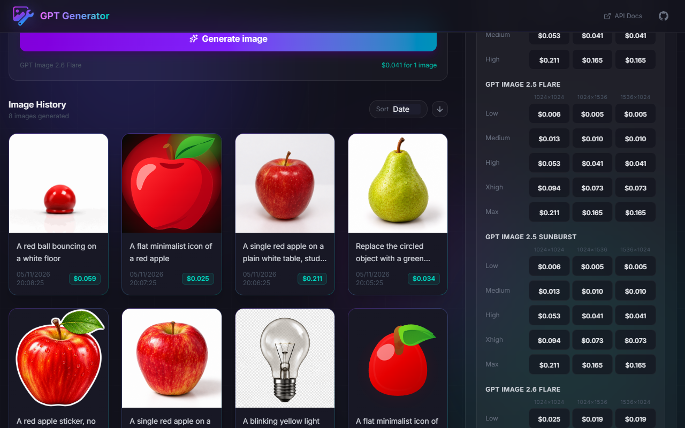

# GPT Image Generator ✨

[](https://svelte.dev/docs/kit)
[](https://tailwindcss.com/)
[](https://openai.com/)
[](https://www.typescriptlang.org/)

A modern web application built with SvelteKit 3 and Tailwind CSS that allows users to generate stunning images using OpenAI's image generation models.

**Website**: [https://gpt-images.ayfri.com](https://gpt-images.ayfri.com)



## Features

*   **AI Image Generation**: Creates images from text prompts with `gpt-image-2`, GPT Image 2.5 Flare and Sunburst, and GPT Image 2.6 Flare and Sunburst (default: 2.6 Flare). Quality goes up to `xhigh` and `max` on 2.5 and 2.6, and 2.6 adds a complexity setting.
*   **Output Formats**: PNG, JPEG and WebP, plus animated GIF (2 to 16 frames, 512 or 768 squares) and SVG (a vector image authored by a text model) on GPT Image 2.6.
*   **Image Editing**: Edits with up to 16 reference images and an optional mask.
*   **Markup Edits**: Draw on the first reference image (brush color and size, undo, clear) to guide the edit with GPT Image 2.5 and 2.6. Can't be combined with a mask.
*   **API Key Management**: Stores your OpenAI API key in the browser's `localStorage` (key `openai-api-key`). The key never leaves your browser except in requests to OpenAI.
*   **Image Gallery**: Displays previously generated images.
*   **Regenerate Option**: Easily regenerate an image with the same prompt.
*   **Usage Statistics**: Shows the total spent, using the real cost computed from the API usage for each image (estimate for older images), plus a table of estimated prices.
*   **Responsive Design**: Adapts beautifully to different screen sizes thanks to Tailwind CSS.
*   **Modern UI**: Clean and intuitive user interface built with Svelte.
*   **SEO Optimized**: Includes comprehensive meta tags and Open Graph properties for better search engine visibility and social sharing.

## Tech Stack

*   **Framework**: SvelteKit 3 (Svelte 5)
*   **Styling**: Tailwind CSS
*   **Language**: TypeScript
*   **AI**: OpenAI API
*   **Icons**: Lucide Svelte
*   **Client-side Storage**: IndexedDB via `idb` for image metadata, OPFS (Origin Private File System, `src/lib/db/opfsStore.ts`) for the image files
*   **Package Manager**: Bun
*   **Build Tool**: Vite
*   **Hosting**: Cloudflare Workers (`@sveltejs/adapter-cloudflare`, deployed with Wrangler)

## Getting Started

### Prerequisites

*   Node.js (v22.17 or higher)
*   Bun (see [bun.sh](https://bun.sh/))
*   An OpenAI API Key (Get one from [OpenAI Platform](https://platform.openai.com/))

### Installation & Setup

1.  **Clone the repository:**
    ```bash
    git clone https://github.com/Ayfri/gpt-images.git
    cd gpt-images
    ```

2.  **Install dependencies:**
    ```bash
    bun install
    ```

The application reads no environment variables. The API key is entered in the UI and stored in the browser's `localStorage`. Be mindful of security implications when handling API keys.

### Running the Development Server

```bash
bun run dev
```

This command starts a local development server. Open your browser and navigate to `http://localhost:5173` (or the port specified in the output).

Enter your OpenAI API key in the application's UI to start generating images.

### Building for Production

```bash
bun run build
```

This command creates an optimized production build in the `.svelte-kit/cloudflare` directory, which `wrangler.jsonc` points to for the Worker and its static assets. Deploy it with `bunx wrangler deploy`.

### Previewing the Production Build

```bash
bun run preview
```

This command starts a local server to preview the production build.

### Type Checking

```bash
bun run check
```

## Project Structure

```
gpt-images/
├── .svelte-kit/      # SvelteKit build artifacts (generated)
├── node_modules/     # Project dependencies (managed by Bun)
├── src/
│   ├── app.css       # Global CSS styles and Tailwind CSS 4 configuration
│   ├── app.html      # HTML template shell
│   ├── assets/       # Static assets imported by modules
│   ├── lib/          # Application library, imported as `#lib/...`
│   │   ├── components/ # Reusable Svelte components
│   │   ├── db/         # Image metadata (IndexedDB), image files (OPFS) and storage migrations
│   │   ├── services/   # API interactions (OpenAI)
│   │   ├── stores/     # Svelte stores
│   │   ├── types/      # Shared types and model definitions
│   │   └── utils/      # Utility functions
│   └── routes/       # Application pages
│       ├── +layout.svelte # Root layout component
│       └── +page.svelte   # Main page component
├── static/           # Static assets served as-is (logo, robots.txt, screenshot)
├── .gitignore        # Files/folders ignored by Git
├── bun.lock          # Exact dependency versions
├── package.json      # Project metadata, dependencies and `#lib` import map
├── README.md         # This file
├── tsconfig.json     # TypeScript configuration
├── vite.config.ts    # Vite and SvelteKit configuration (adapter included)
└── wrangler.jsonc    # Cloudflare Workers configuration
```

## Contributing

Contributions are welcome! Please follow standard fork-and-pull-request workflows.

## License

This project is licensed under the MIT License - see the LICENSE file for details (if applicable).
